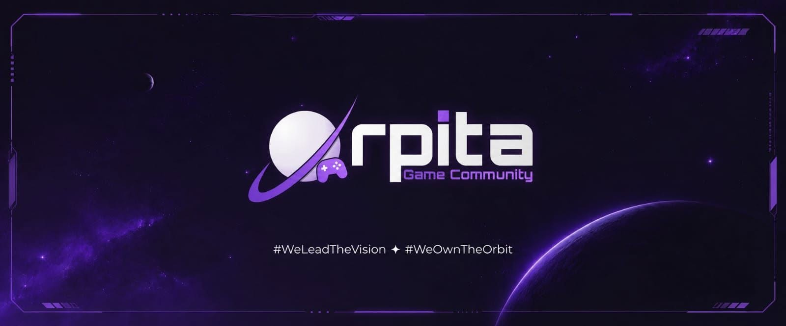
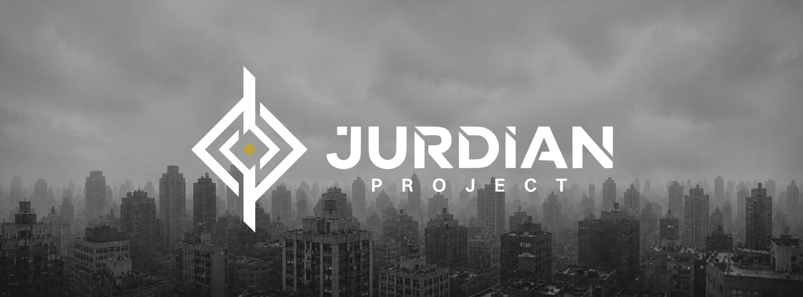

# AMR ELMAHDY

### Building games, ARGs, websites, and tools.

Founder of [**Orpita Game Community**](https://github.com/Orpita-Community) · Creator of [**Jurdian Project**](https://github.com/Jurdian-Project)

I design games and the teams behind them, from concept to playable games. I also build ARG experiences, puzzles, ciphers, and I'm really good at hiding information. And on top of that, I build websites, tools, and automate small things.

&nbsp;•&nbsp;
&nbsp;•&nbsp;

## Currently working on 

- **[Jurdian Cipher Wiki](https://github.com/Jurdian-Project/jurdian-cipher-wiki)** — a wide collection of ciphers with study and usage for each. Built for Jurdian, but usable by anyone interested in cryptography.

- **[Orpita Community Website](https://github.com/amrelmahdy001/orpita-community-web)** — a new home for the Orpita community, still in active development — but you can visit the website and see how far it's come.

- **[Charmly](https://github.com/amrelmahdy001/Charmly)** — an icon API for READMEs, growing with more icons and new display tools like widgets.

## Orpita Game Community

  

A volunteer-driven Egyptian game dev community that I founded and run. Artists, developers, writers, and musicians — coming together to build games through jams and small projects.

**48+** members &nbsp;•&nbsp; **5** games shipped &nbsp;•&nbsp; **1.5+** years running

Inside Orpita, I handle game design, team coordination, and the systems that keep projects moving.

### Featured Games

### Connect

&nbsp;•&nbsp;
&nbsp;•&nbsp;
&nbsp;•&nbsp;
&nbsp;•&nbsp;
&nbsp;•&nbsp;
&nbsp;•&nbsp;

---
## Jurdian Project

  

A non-horror ARG built around ciphers, hidden information, and collaborative investigation. Inspired by Cicada 3301 — designed for the online world, with pieces that don't stay on the screen.

The first ARG of its kind in Egypt. Currently building the infrastructure: ciphers, tools, databases, platforms, and puzzles. New pieces get released over time, not all at once.

### Tools

### Connect

&nbsp;•&nbsp;
&nbsp;•&nbsp;

---

## Tools & Side Projects

Small things I build on the side — tools, experiments, and utilities that solve a specific problem.

---

> Built and maintained by Amr Elmahdy. If something here caught your eye, [reach out](mailto:amrelmahdy001@gmail.com)